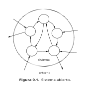
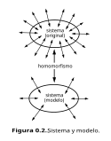

# Lección 0: Modelos y Niveles

## 0.1 Propósito

Los ordenadores se pueden contemplar desde muy distintos puntos de vista, dependiendo de la formación y de la profesión del observador, de la naturaleza de su relación con esos ordenadores e, incluso, de su intención en un momento dado. Aunque limitemos las relaciones y las intenciones a las referentes a un punto de vista técnico e instrumental, hay diversos puntos de vista. ¿Cuáles? Sorprendentemente (al fin y al cabo estamos hablando de "simples máquinas"), una respuesta (que no sea trivial) exige desarrollar previamente cierto marco conceptual. Y éste es nuestro primer propósito. Una vez obtenida la respuesta será relativamente fácil cumplir el propósito último (de esta lección): situar en ese marco los contenidos de este libro.

Veremos que para describir a los ordenadores hay diferentes *modelos*, y que cada modelo se construye a partir de unos elementos que se combinan siguiendo ciertas reglas. O, lo que es igual, cada modelo se expresa en un *lenguaje*. En las lecciones siguientes estudiaremos esos modelos y esos lenguajes. Pero en ésta vamos a hablar de los propios modelos y de los propios lenguajes. Vamos, por tanto, a construir un *metamodelo*, usando la lengua española como *metalenguaje*. En este sentido prodemos también decir que ésta es una *metalección*.

En consecuencia, esta (meta)lección tiene una naturaleza más abstracta y generalista y un enfoque menos técnico que el resto del curso. Su objetivo es delimitar y acotar el contenido de éste, y, al tiempo, contribuir a sistematizar el estudio de los ordenadores. Pero su lectura, aunque la creemos recomendable (de lo contrario, habríamos ahorrado en todos los sentidos estas trinta y tres páginas), no es estrictamente obligatoria para comprender las lecciones que le siguen. Si se omite, "sólo" se perderá cierta perspectiva global. El lector poco aficionado a visiones globalistas y más propenso a "ir al grano" tiene la opción de leer el Resumen (apartado 0.9) y pasar luego sin más preámbulos, a la lección 1.

Ahora bien, antes de que corra a hacerlo le pedimos que termine este párrafo. La *abstracción** tiene una connotación peyorativa para muchas personas con pretendida vocación por la ingeniería ("esta explicación, este libro, esta asignatura, son demasiado abstractos...", "vayamos al grano, concretemos..."). Invitamos al lector a reflexionar seriamente sobre la siguiente proposición: *sin abstracción no hay ingeniería; todo lo más, habría artesanía*

## 0.2 Sistemas, complejidad y modelos

Un ordenador es un *sistema complejo* que puede describirse mediante diferentes *modelos* en distintos *niveles* de una *jerarquía de abstracciones*.[^1] Todo lo que sigue en esta lección está dedicado a explicar el significado de este escueto (y seguramente críptico para el lector) mensaje, y a extraer consecuencias del mismo.

### Sistemas

La acepción de "sistema" que aquí nos interesa es la segunda del D.R.A.E.[^2]: "conjunto de cosas que ordenadamente relacionadas entre sí contribuyen a determinado objeto". Entendiendo "cosa" en un sentido amplio,[^3] designa a un concepto generalizador que conduce, por una parte, a lo que se ha llamado "pensamiento sistémico" (necesidad de enfoques globalizadores por contraposición a, o complementarios, de los reduccionistas de las ciencias clásicas), y, por otra, a las "teorías generales de sistemas" (o "teorías de sistemas generales"), construcciones abstractas (en sí mismas, sistemas) que pretenden aplicarse a disciplinas muy diversas.

Sin entrar en tales temas más de lo estrictamente necesario para nuestro propósito, hemos de comentar algunos puntos que consideramos importantes para la comprensión de los sistemas llamados ordenadores.

Los sistemas pueden ser **materiales** o **conceptuales**. Un ordenador, un automóvil, un edificio, incluso un hombre (despojado éste último de cualquier connotación idealista o espiritual),[^4] son sistemas materiales. Un manual de programación, un esquema de las partes del automóvil y sus relaciones, los planos del edificio, la fisiología, son sistemas concepturales.

Estos ejemplos de sistemas conceptuales son también sistemas **abstraídos**: cada uno de ellos existe porque existe (o puede llegar a existir) un sistema material que se corresponde con él, y cada uno es un *modelo* (en el sentido que definiremos más adelante) del correspondiente sistema material (el manual es un modelo del ordenador, etc). *Estos son los sistemas conceptuales que aquí nos interesan*, no otros, como las teorías matemáticas o linguísticas, que son sistemas **abstractos** cuya existencia no está ligada a la de ningún sistema material.

Los sistemas conceptuales son elaboraciones de la mente humana. En ellos suele estar claro (o debería estarlo) cuáles son las "cosas", o partes, que los componen: en general, son símbolos (gráficos, palabras, números). En los sistemas materiales no está tan claro: en el límite, las partes serían las "partículas elementales" de la Física. Sin embargo, nadie piensa así cuando fija su atención, por ejemplo, en el sistema solar; más bien considerará que las partes son el sol, los planetas y sus satélites, admitiendo que todos éstos son, a su vez, sistemas, o sea, **subsistemas** con relación al sistema del que forman parte. En general, cuando estudiamos un sistema material lo consideramos formado por subsistemas, también materiales, en cuya composición no entramos; y, además, **idealizamos** cada uno de estos subsistemas, es decir, que nos quedamos con las características que consideramos relevantes para nuestros fines y **hacemos abstracción de** las que no lo son. Pero al actuar así lo que hacemos es, realmente, construir un sistema conceptual, un **modelo** del sistema original.

### Sistemas abiertos

Desde el mismo momento en que consideramos un sistema estamos particionando el conjunto de las "cosas" del universo en dos: las que forman el sistema y todas las demás; estas últimas constituyen el **entorno** del sistema considerado. Hay sistemas conceptuales (sistemas lingüisticos, sistemas algebraicos, etc.) que son **cerrados:** se puede establecer una frontera impermeable entre el sistema y el entorno. Pero todos los sistemas materiales son, en mayor o menor medida, **abiertos**: hay partes del sistema que interactúan con las del entorno (es decir, que influyen sobre o que son influidas por ellas). En general, un sistema abierto es aquél que *intercambia materia y/o energía y/o información con su entorno*. La figura 0.1 (en la que los círculos representan las partes o subsistemas, y las flechas las influencias o interacciones) ilustra esta definición.

Un ordenador es, desde luego, un sistema abierto: recibe datos y entrega resultados y, por tanto, intercambia información con el entorno.[^5] Y, aunque a efectos meramente didácticos podemos estudiar su funcionamiento interno independientemente de su función, su existencia sólo se justifica porque los beneficios que socialmente reporta este intercambio son (supuestamente) más relevantes que los costes que le acompañan.

Esta definición de "sistema abierto" es clásica en las teorías de sistemas. En el campo de los ordenadores se utiliza de una forma mucho más concreta y restrictiva. Lo veremos en el apartado 17.8.

### Sistemas complejos

La complejidad es una propiedad que atribuimos, casi siempre de manera subjetiva,[^6] a ciertos sistemas. Herbert Simon ha definido un *sistema complejo* como "el compuesto por un gran número de partes que actúan entre sí de manera no sencilla".[^7] La imprecisión de esta definición no es ajena al hecho de que la complejidad no es un atributo del sistema en sí: depende tanto del sistema como del observador. Casi todos los sistemas en los que centremos nuestra atención pueden parecernos simples o complejos, dependiendo de que dispongamos o no de descripciones suficientemente buenas para responder a las preguntas, o resolver los problemas que nos planteamos. De ahí que haya una constante en la evolución del pensamiento: la búsqueda de descripciones comprensibles de sistemas que, en principio, parecen complejos (o más complejos de lo que luego resultan ser cuando se llega a la descripción adecuada).

De los cuatro ejemplos de sistemas citados más arriba, el ordenador, el automóvil, el edificio y el hombre, seguramente muchos lectores considerarían en primera instancia como complejos sólo el primero y el último, no los otros dos. Y es así porque disponen de *descripciones comprensibles* del automóvil y del edificio que les permiten predecir su función y/o su comportamiento para resolver los problemas que se les plantean habitualmente, y no así de los otros dos.

La invención de buenas descripciones (o buenos *modelos*) es importante para *comprender la realidad* (actividad del filósofo y del científico), para *actuar sobre ella* (actividad del muchos otros profesionales: médicos, economistas, políticos...), para *concebir, construir o reparar artefactos* (actividad del ingeniero) y para movernos en una y utilizar adecuadamente los otros (actividad de todos). Pero en todos los casos hay que ser precavidos, so pena de resultar incautos. Desde el punto de vista científico y filosófico, no se debe confundir la realidad con el modelo que, esclavos de nuestra percepción, construimos.[^8] Y, desde el punto de vista de la ingeniería, el diseño de artefactos siguiendo modelos de los mismos lleva consigo el riesgo de creer que el artefacto es el modelo, y sin embargo éste ignora comportamientos que pueden ser importantes. Esto es especialmente cierto en lo concerniente a la integración del artefacto en el entorno social, asunto lamentablemente olvidado en la tradición académica ingenieril, y relacionado con lo que Mario Bunge llama "tecnopraxeología".[^9]

Para un mismo sistema, el ordenador en nuestro caso, podemos utilizar descripciones muy distintas, según cuál sea el fin de la descripción.

### Modelos

Ya hemos utilizado varias veces la palabra *modelo* como sinónimo de *descripción*. Ahora bien, similarmente a lo que ocurre con el término "sistema", "modelo" tiene varias acepciones. En el campo de los ordenadores se habla, por ejemplo, del "modelo de von Neumann" o del "modelo de Wilkes" para referirse a esquemas generales que sirven de guía para el diseño de ordenadores, o del "modelo tal de tal ordenador", aluciendo a un sistema determinado del que se fabrican muchas réplicas.

En la acepción que aquí nos interesa, un modelo es, en sí mismo, un sistema, material o conceptual, que se utiliza en lugar de otro[^10] al que, por su relación con el modelo, podemos llamar **original**.

El *modelado* de un sistema consiste en buscar o elaborar un modelo del mismo. Es un proceso intelectual pragmático y unidireccional (se *utiliza* un modelo *en sustitución* de un original) que está presente en todo desarrollo teórico o aplicado, pero también en toda actividad humana (actuamos siempre suponiendo ciertas pautas o modos de comportamiento de las cosas y seres que nos rodean).

Todo modelo es homomórfico (en el sentido matemático de la palabra, no en el etimológico) con el sistema original al que sustituye. Esto es, la correspondencia entre ambos no es isomórfica o biunívoca: el modelo sólo refleja los rasgos de interés del original (figura 0.2).

### Aspectos semióticos de los modelos

🚧 TODO 🚧

[^1]: Obsérvese que este enunciado no es una definición de ordenador, sino la declaración de unas propiedades del mismo. Dicho de otro modo, en él se utiliza el verbo "ser" en el sentido de la *predicación*, no en el de la *identidad*. (J. Ferrater h H. Leblanc: *Lógica matemática*. Fondo de Cultura Económica, México, 1962).

[^2]: Diccionario de la Real Academia Española, vigesimoprimera edición (1992), que citaremos con frecuencia

[^3]: O sea, pudiendo denotar tanto objetos físicos de nuestro entorno material como objetos conceptuales elaborados por la mente. Como dice Javier Aracil: "Se aplica ["cosa"] a todo aquello que nos rodea ante lo que se puede preguntar significativamente: *¿qué es eso?* Se excluye únicamente aquello ante lo que, siguiendo la sugerencia de los orteguianos, cabe cuestionar: *¿quién es ese?* (J. Aracil: *Máquinas, sistemas y modelos. Un ensayo sobre sistémica*. Tecnos, Madrid, 1986).

[^4]: Según el criterio de Aracil citado en la nota anterior, un hombre no es una "cosa", pero sí podría ser un sistema compuesto por cosas. Por otra parte, cuando se estudian sistemas de los que el hombre forma parte (sistemas sociales, sistemas hombre-máquina, etc.) es ogligado tomar el punto de vista del hombre como "cosa".

[^5]: Tabmién intercambia energía, pero los modelos que aquí nos interesan hacen abstracción de este hecho. Obsérvese que el mismo concepto de "información" implica una abstracción: la información ha de tener un soporte para ser almacenada y comunicada, y este soporte implica algún tipo de energía.

[^6]: "La complejidad de un objeto está en los ojos del observador". G.J. Klir: "Complexity: some general observations". *System Research*, 2, 2 (1985), pp. 131-140.

[^7]: H.A. Simon: *The sciences of the Artificial.* M.I.T. Press, 1973. Traducción de F. Gironella: *Las ciencias de lo artificial.* A.T.E., Barcelona, 1978.

[^8]: "No es que tu teoría sea tan amplia como la realidad; es que tu percepción de la realidad es tan estrecha como tu teoría". K. Craik: *The Nature of Explanation*. Cambridge University Press, Cambridge, 1943.

[^9]: M. Bunge: *Epistemología*. Ariel, Barcelona, 1980.

[^10]: "5. Esquema teórico, generalmente en forma matemática, de un sistema o de una realidad compleja (por ejemplo, la evolución económica de un país), que se elabora para facilitar su comprensión y el estudio de su comportamiento". (D.R.A.E.)
