# Lección 0: Modelos y Niveles

## 0.1 Propósito

Los ordenadores se pueden contemplar desde muy distintos puntos de vista, dependiendo de la formación y de la profesión del observador, de la naturaleza de su relación con esos ordenadores e, incluso, de su intención en un momento dado. Aunque limitemos las relaciones y las intenciones a las referentes a un punto de vista técnico e instrumental, hay diversos puntos de vista. ¿Cuáles? Sorprendentemente (al fin y al cabo estamos hablando de "simples máquinas"), una respuesta (que no sea trivial) exige desarrollar previamente cierto marco conceptual. Y éste es nuestro primer propósito. Una vez obtenida la respuesta será relativamente fácil cumplir el propósito último (de esta lección): situar en ese marco los contenidos de este libro.

Veremos que para describir a los ordenadores hay diferentes *modelos*, y que cada modelo se construye a partir de unos elementos que se combinan siguiendo ciertas reglas. O, lo que es igual, cada modelo se expresa en un *lenguaje*. En las lecciones siguientes estudiaremos esos modelos y esos lenguajes. Pero en ésta vamos a hablar de los propios modelos y de los propios lenguajes. Vamos, por tanto, a construir un *metamodelo*, usando la lengua española como *metalenguaje*. En este sentido prodemos también decir que ésta es una *metalección*.

En consecuencia, esta (meta)lección tiene una naturaleza más abstracta y generalista y un enfoque menos técnico que el resto del curso. Su objetivo es delimitar y acotar el contenido de éste, y, al tiempo, contribuir a sistematizar el estudio de los ordenadores. Pero su lectura, aunque la creemos recomendable (de lo contrario, habríamos ahorrado en todos los sentidos estas treinta y tres páginas), no es estrictamente obligatoria para comprender las lecciones que le siguen. Si se omite, "sólo" se perderá cierta perspectiva global. El lector poco aficionado a visiones globalistas y más propenso a "ir al grano" tiene la opción de leer el Resumen (apartado 0.9) y pasar luego sin más preámbulos, a la lección 1.

Ahora bien, antes de que corra a hacerlo le pedimos que termine este párrafo. La *abstracción* tiene una connotación peyorativa para muchas personas con pretendida vocación por la ingeniería ("esta explicación, este libro, esta asignatura, son demasiado abstractos...", "vayamos al grano, concretemos..."). Invitamos al lector a reflexionar seriamente sobre la siguiente proposición: *sin abstracción no hay ingeniería; todo lo más, habría artesanía*

## 0.2 Sistemas, complejidad y modelos

Un ordenador es un *sistema complejo* que puede describirse mediante diferentes *modelos* en distintos *niveles* de una *jerarquía de abstracciones*.[^1] Todo lo que sigue en esta lección está dedicado a explicar el significado de este escueto (y seguramente críptico para el lector) mensaje, y a extraer consecuencias del mismo.

### Sistemas

La acepción de "sistema" que aquí nos interesa es la segunda del D.R.A.E.[^2]: "conjunto de cosas que ordenadamente relacionadas entre sí contribuyen a determinado objeto". Entendiendo "cosa" en un sentido amplio,[^3] designa a un concepto generalizador que conduce, por una parte, a lo que se ha llamado "pensamiento sistémico" (necesidad de enfoques globalizadores por contraposición a, o complementarios, de los reduccionistas de las ciencias clásicas), y, por otra, a las "teorías generales de sistemas" (o "teorías de sistemas generales"), construcciones abstractas (en sí mismas, sistemas) que pretenden aplicarse a disciplinas muy diversas.

Sin entrar en tales temas más de lo estrictamente necesario para nuestro propósito, hemos de comentar algunos puntos que consideramos importantes para la comprensión de los sistemas llamados ordenadores.

Los sistemas pueden ser **materiales** o **conceptuales**. Un ordenador, un automóvil, un edificio, incluso un hombre (despojado éste último de cualquier connotación idealista o espiritual),[^4] son sistemas materiales. Un manual de programación, un esquema de las partes del automóvil y sus relaciones, los planos del edificio, la fisiología, son sistemas concepturales.

Estos ejemplos de sistemas conceptuales son también sistemas **abstraídos**: cada uno de ellos existe porque existe (o puede llegar a existir) un sistema material que se corresponde con él, y cada uno es un *modelo* (en el sentido que definiremos más adelante) del correspondiente sistema material (el manual es un modelo del ordenador, etc). *Estos son los sistemas conceptuales que aquí nos interesan*, no otros, como las teorías matemáticas o linguísticas, que son sistemas **abstractos** cuya existencia no está ligada a la de ningún sistema material.

Los sistemas conceptuales son elaboraciones de la mente humana. En ellos suele estar claro (o debería estarlo) cuáles son las "cosas", o partes, que los componen: en general, son símbolos (gráficos, palabras, números). En los sistemas materiales no está tan claro: en el límite, las partes serían las "partículas elementales" de la Física. Sin embargo, nadie piensa así cuando fija su atención, por ejemplo, en el sistema solar; más bien considerará que las partes son el sol, los planetas y sus satélites, admitiendo que todos éstos son, a su vez, sistemas, o sea, **subsistemas** con relación al sistema del que forman parte. En general, cuando estudiamos un sistema material lo consideramos formado por subsistemas, también materiales, en cuya composición no entramos; y, además, **idealizamos** cada uno de estos subsistemas, es decir, que nos quedamos con las características que consideramos relevantes para nuestros fines y **hacemos abstracción de** las que no lo son. Pero al actuar así lo que hacemos es, realmente, construir un sistema conceptual, un **modelo** del sistema original.

### Sistemas abiertos

Desde el mismo momento en que consideramos un sistema estamos particionando el conjunto de las "cosas" del universo en dos: las que forman el sistema y todas las demás; estas últimas constituyen el **entorno** del sistema considerado. Hay sistemas conceptuales (sistemas lingüisticos, sistemas algebraicos, etc.) que son **cerrados:** se puede establecer una frontera impermeable entre el sistema y el entorno. Pero todos los sistemas materiales son, en mayor o menor medida, **abiertos**: hay partes del sistema que interactúan con las del entorno (es decir, que influyen sobre o que son influidas por ellas). En general, un sistema abierto es aquél que *intercambia materia y/o energía y/o información con su entorno*. La figura 0.1 (en la que los círculos representan las partes o subsistemas, y las flechas las influencias o interacciones) ilustra esta definición.

Un ordenador es, desde luego, un sistema abierto: recibe datos y entrega resultados y, por tanto, intercambia información con el entorno.[^5] Y, aunque a efectos meramente didácticos podemos estudiar su funcionamiento interno independientemente de su función, su existencia sólo se justifica porque los beneficios que socialmente reporta este intercambio son (supuestamente) más relevantes que los costes que le acompañan.

Esta definición de "sistema abierto" es clásica en las teorías de sistemas. En el campo de los ordenadores se utiliza de una forma mucho más concreta y restrictiva. Lo veremos en el apartado 17.8.

### Sistemas complejos

La complejidad es una propiedad que atribuimos, casi siempre de manera subjetiva,[^6] a ciertos sistemas. Herbert Simon ha definido un *sistema complejo* como "el compuesto por un gran número de partes que actúan entre sí de manera no sencilla".[^7] La imprecisión de esta definición no es ajena al hecho de que la complejidad no es un atributo del sistema en sí: depende tanto del sistema como del observador. Casi todos los sistemas en los que centremos nuestra atención pueden parecernos simples o complejos, dependiendo de que dispongamos o no de descripciones suficientemente buenas para responder a las preguntas, o resolver los problemas que nos planteamos. De ahí que haya una constante en la evolución del pensamiento: la búsqueda de descripciones comprensibles de sistemas que, en principio, parecen complejos (o más complejos de lo que luego resultan ser cuando se llega a la descripción adecuada).

De los cuatro ejemplos de sistemas citados más arriba, el ordenador, el automóvil, el edificio y el hombre, seguramente muchos lectores considerarían en primera instancia como complejos sólo el primero y el último, no los otros dos. Y es así porque disponen de *descripciones comprensibles* del automóvil y del edificio que les permiten predecir su función y/o su comportamiento para resolver los problemas que se les plantean habitualmente, y no así de los otros dos.

La invención de buenas descripciones (o buenos *modelos*) es importante para *comprender la realidad* (actividad del filósofo y del científico), para *actuar sobre ella* (actividad del muchos otros profesionales: médicos, economistas, políticos...), para *concebir, construir o reparar artefactos* (actividad del ingeniero) y para movernos en una y utilizar adecuadamente los otros (actividad de todos). Pero en todos los casos hay que ser precavidos, so pena de resultar incautos. Desde el punto de vista científico y filosófico, no se debe confundir la realidad con el modelo que, esclavos de nuestra percepción, construimos.[^8] Y, desde el punto de vista de la ingeniería, el diseño de artefactos siguiendo modelos de los mismos lleva consigo el riesgo de creer que el artefacto es el modelo, y sin embargo éste ignora comportamientos que pueden ser importantes. Esto es especialmente cierto en lo concerniente a la integración del artefacto en el entorno social, asunto lamentablemente olvidado en la tradición académica ingenieril, y relacionado con lo que Mario Bunge llama "tecnopraxeología".[^9]

Para un mismo sistema, el ordenador en nuestro caso, podemos utilizar descripciones muy distintas, según cuál sea el fin de la descripción.

### Modelos

Ya hemos utilizado varias veces la palabra *modelo* como sinónimo de *descripción*. Ahora bien, similarmente a lo que ocurre con el término "sistema", "modelo" tiene varias acepciones. En el campo de los ordenadores se habla, por ejemplo, del "modelo de von Neumann" o del "modelo de Wilkes" para referirse a esquemas generales que sirven de guía para el diseño de ordenadores, o del "modelo tal de tal ordenador", aluciendo a un sistema determinado del que se fabrican muchas réplicas.

En la acepción que aquí nos interesa, un modelo es, en sí mismo, un sistema, material o conceptual, que se utiliza en lugar de otro[^10] al que, por su relación con el modelo, podemos llamar **original**.

El *modelado* de un sistema consiste en buscar o elaborar un modelo del mismo. Es un proceso intelectual pragmático y unidireccional (se *utiliza* un modelo *en sustitución* de un original) que está presente en todo desarrollo teórico o aplicado, pero también en toda actividad humana (actuamos siempre suponiendo ciertas pautas o modos de comportamiento de las cosas y seres que nos rodean).

Todo modelo es homomórfico (en el sentido matemático de la palabra, no en el etimológico) con el sistema original al que sustituye. Esto es, la correspondencia entre ambos no es isomórfica o biunívoca: el modelo sólo refleja los rasgos de interés del original (figura 0.2).

### Aspectos semióticos de los modelos

La semiótica es una teoría lógica general de los sistemas de símbolos. Siendo los lenguajes sistemas de símbolos, la semiótica tiene funciones de metalenguaje. En ella se consideran tres partes: la **sintaxis** estudia exclusivamente los símbolos y las leyes para su combinación; la **semántica** se ocupa del significado de los símbolos, es decir, de su relación con los objetos que designan; y la **pragmática** trata de las relaciones de los símbolos y construcciones del lenguaje con las personas que los utilizan. Así, al enunciar cosas como "`ordenador` es un sustantivo" o "`ordenador` es también un adjetivo" nos movemos en el campo de la sintaxis; al decir "un ordenador (sustantivo) es un artefacto pensado para liberar a la mente humana de tareas rutinarias" o "`ordenador` (sustantivo) es un vocablo de origen francés que designa a ciertas máquinas también llamadas computadores" estamos en el campo de la semántica, y al afirmar que "hay quien ve un peligro en los ordenadores" o "todos somos usuarios y víctivamos de los ordenadores" pasamos al campo de la pragmática.

En los modelos en general podemos también identificar esas tres vertientes. En efecto, los modelos se construyen siguiendo ciertas reglas para combinar elementos (sintaxis), representan a un sistema original (semántica) y sirven para un fin (pragmática). La figura 0.3 ilustra estas relaciones entre el modelo, el sistema que representa y las personas que lo usan.

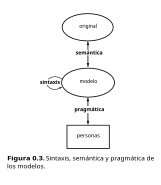

### Tipos de modelos

Las anteriores consideraciones nos sirven para establecer un marco de clasificación de los modelos siguiendo los tres niveles semióticos. Pero, además, como sistemas que son, los modelos pueden también clasificarse en materiales y conceptuales (abstraidos). De acuerdo con esto, tenemos una variedad de modelos, según resume la figura 0.4, que pasamos a comentar.

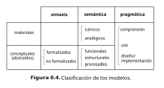

Por su sintaxis, los modelos materiales son tan variados como los distintos tipos de elementos físicos que pueden componerlos (ladrillos, "chips", moléculas, células...) y las reglas para su combinación. No hay clasificación posible. En cuanto a los modelos conceptuales, estarán expresados en algún lenguaje más o menos formalizado. La clasificación de la figura ("formalizaos-no formalizados") en realidad representa los extremos de una gama infinita de posibilidades (entre los modelos puramente matemáticos expresados estrictamente, por ejemplo, en álgebra, y las descripciones totalmente literarias en lengujae natural, normalmente adoptamos una posición intermedia, sea porque matizamos con el lenguaje natural el modelo formal, sea porque procuremos restringir el uso del lengujae natural en las descripciones para evitar ambigüedades). 

Por su semántica, los modelos materiales pueden ser **icónicos** o **analógicos**. Los primeros son aquellos que se construyen con partes de la misma naturaleza física que las partes del original, de modo que el modelo reproduce al original cambiando únicamente la escala de algunas magnitudes, y eventualmente abstrayendo, omitiendo o transformando alguna magnitud. Es el caso de las reproducciones a escala de vehículos para su estudio aerodinámico, o de los mapas topográficos. En este tipo de modelo aparece claramente la propiedad de homomorfismo entre el modelo y el original (en la reproducción a escala de vehículos, si sólo interesa el comportamiento aerodinámico no se incluyen detalles de los subsistemas motor, eléctrico, etc; en los mapas,, aparte del cambio de escala, se transforma la dimensión de altitud mediante el convenio de las líneas de nivel). Los modelos analógicos son también materiales, y están, por tanto, constituidos por objetos concretos, pero de naturaleza diferente a la de las partes del original. Así son, por ejemplo, los "circuitos equivalentes" cuyo comportamiento eléctrico es análogo al de algún sistema mecánico original, como ilustra la figura 0.5.

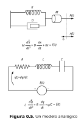

Distiguiremos, desde el punto de vista semántico, tres tipos de modelos conceptuales: *funcionales, estructurales y procesales*. Esta es la clasificación más interesante a los efectos de este libro. Dedicaremos el siguiente apartado a su explicación.

Finalmente, por su pragmática, los modelos (sean materiales o abstraídos) pueden utilizarse, entre otras cosas, para *comprender* al sistema original, para *usarlo*, para *diseñarlo* o para *implementarlo*. En cada caso se tendrá un punto de vista distinto sobre el sistema, y se utilizarán diferentes modelos (materiales o conceptuales, más o menos formalizados, funcionales, estructurales o procesales). De esto hablaremos en el apartado 0.5

## 0.3 Modelos funcionales, estructurales y procesales

### Modelos funcionales

Se obtienen modelos funcionales cuando se pretende describir la **función** del sistema: sus acciones sobre el entorno y sus reacciones a éste.[^11] De todas las interacciones posibles entre el sistema y el entorno se seleccionan algunas para el modelo y se clasifican en **estímulos** (influencias del entorno sobre el sistema) y **respuestas** (influencias del sistema sobre el entorno). Como ilustra la fugura 0.6, el modelo del sistema es una **caja negra**[^12] que recibe estímulos (o "entradas") y genera respuestas (o "salias"). La respuesta ante un determinado estímulo (o sucesión de estímulos) es el **comportamiento** del sistema para este estímulo.

  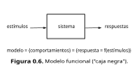

Un modelo funcional de un sistema dinámico es, pues, una descripción de todos los comportamientos del sistema.[^13] Es decir, una descripción de todos los posibles estímulos y todas las posibles respuestas del sistema, y de cómo unos se relacionan con las otras en función del tiempo. Así son los modelos de ordenador definidos en los manuales de programación, el modelo de comportamiento del automóvil que enseñan en las "autoescuelas", o los "modelos del hombre" de la psicología conductista.

Al establecer un modelo funcional se selecciona un número finito de tipos de estímulos y de respuestas (lo que se traduce, al formalizar el modelo, en un número finito de variables de entrada y de salida), y esto ya significa una cierta abstracción, puesto que las relaciones del sistema con el entorno pueden ser innumerables. Por otra parte, hemos dicho que un modelo funcional debe describir todo los estímulos, las respuestas y las relaciones entre unos y otras. Frecuentemente, la enumeración exhaustiva (es decir, para todos los valores posibles de las variables de entrada y salida seleccionadas) es imposible, y se utiliza o bien un modelo funcional incompleto (es el caso del "modelo de autoescuela", que inlcuye el comportamiento dinámico habitual, pero excluye habilidades dominadas sólo por especialistas) o bien una descripción *intensional*, no extensional (es el caso de los modelos de sistemas dinámicos lineales, en los que se utilizan, por ejemplo, "funciones de transferencia", que engloban en una sola fórmula, como las de la figura 0.5, las infinitas relaciones posibles entre las entradas y las salidas).

### Modelos estructurales

Un modelo estructural trata de profundizar en la organización del sistema como conjunto de partes interrelacionadas. En la mayoría de las definiciones de "sistema" (como la reproducida más arriba) subyace una concepción estructural. Un modelo estructural comprende a los componentes del sistema (subsistemas), definidos de manera funcional, y a las relaciones entre estos componentes (figura 0.7). Ambas cosas, si están completamente especificadas, determinan (al menos, teóricamente) la *función* del sistema. Modelos estructurales que determinan los modelos funcionales de los tres sistemas citados más arriba son: componentes básicos (memorias, registros, etc.), con sus conexiones y leyes de interacción para el ordenador, partes mecánicas y leyes de la mecánica para el automóvil, y conceptos y leyes de la psicología cognoscitiva para el hombre.

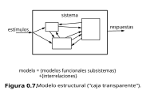

Ahora bien, siendo los modelos representaciones aproximadas de los sistemas, la "determinación" del modelo funcional a partir del estructural es siempre relativa. Así, los modelos de la psicología cognoscitiva son (al menos de momento) demasiado burdos para poder deducir de ellos las leyes de la psicología conductista. Y aun si los modelos funcionales de los componentes son suficientemente precisos, en la práctica el proceso deductivo puede ser inabordable (como deducir el comportamiento de una persona a partir de un perfecto conocimiento de la bioquímica). Por eso hemos matizado más arriba que el modelo estructural determina *teóricamente* al funcional. Y por eso, para el estudio de sistemas complejos se introducen modelos en distintos niveles de abstracción. Elevar el nivel de abstracción permite elaborar modelos útiles para sistemas complejos pero sacrificando la posibilidad de que los modelos en un nivel alto puedan estar completamente determinados por los de un nivel más bajo. En general, esta indeterminación justifica el aforismo aristotélico "el todo es más que la suma de sus partes", que en los sistemas se traduce por la aparición de **propiedades emergentes:**[^14] las que resultan como consecuencia de interacciones entre las partes y no pueden deducirse mediante análisis del modelo estructural.

Uno podría esperar que las cosas fuesen más favorables en un sistema más "determinista" como es el ordenador, y que el perfecto conocimiento de sus componentes e interacciones nos permitiese predecir todos sus posibles comportamientos. O, dicho en términos más prácticos, que dado un programa y unos datos, pudiésemos inferir, con toda certeza, cuáles van a ser los resultados. Pero no es así. El ordenador no es tan complejo como muchos sistemas vivos, pero sí lo suficiente como para que sus descripciones tengan que hacerse en distintos niveles de abstracción, y lo dicho en el párrafo anterior le es también aplicable. Volveremos sobre los niveles en el apartado 0.7, pero señalemos aquí la trascendencia de este hecho. En efecto, por una parte es el desencadenante de toda una problemática en la ingeniería del software: la de tratar de conseguir que los programas funcionen correctamente.[^15] Por otra, es posible diseñar programas que exhiban comportamientos imprevisibles o "emergentes". El **aprendizaje** en el ordenador se consigue si esos comportamientos van "mejorando" en algún sentido. Es éste un campo de gran potencialidad, y del que ya existen aplicaciones interesantes, pero no lo trataremos en este libro.

Sigamos con los modelos estructurales y con un ejemplo que nos permitirá insistir en la idea insinuada sobre la posibilidad de aprendizaje en los ordenadores. Es frecuente que un mismo sistema, con un determinado modelo funcional, pueda representarse por distintos modelos estructurales. Dicho de otro modo, el modelador, dependiendo de su punto de vista o de su intención (pragmática) puede adoptar distintas *descomposiciones*. Consideremos el sistema familiar de un ordenador personal con pantalla gráfica, teclado y ratón (nos olvidaremos, para simplificar, de discos y otras unidades). Este ya no es un modelo estructural, suficiente para muchos usuarios y vendedores de ordenadores. Pero si uno no se conforma con considerar la "caja" como una "caja negra", y abre la carcasa, con unos mínimos conocimientos puede identificar fácilmente cuatro grandes componentes: la fuente de alimentación, la "placa madre" (que incluye los circuitos de la unidad central de procesamiento y de la memoria principal), la placa controladora de vídeo y una placa más pequeña con unos circuitos para controlar al ratón (los del teclado suelen estar incluidos en la placa madre). Uno puede rápidamente establecer el modelo de la figura 0.8(a) (página siguiente). O bien puede decidir que no le interesa lo que se refiere al suministro de energía ni a la disposición física, y, *haciendo abstracción* de tales cosas, agrupar los componentes de más bajo nivel (los circuitos) por su función. Puede llegar así al modelo "clásico" (que estudiaremos con detalle a partir de la lección 1) que muestra la figura 0.8(b). Pero cabe también que no le interesen en absoluto estas descomposiciones en componentes físicos, sino otra que sea de más utilidad para describir lo que ocurre en la ejecución de un determinado programa. Sea éste uno que lee del teclado un número natural, lo convierte a la representación binaria interna, utiliza una función para calcular el factorial del dato leído, convierte la representación binaria del resultado a decimal y presenta este resultado decimal por la pantalla. Una posible descomposición es la de la figura 0.8(c), en la que se han agrupado las operaciones de lectura, escritura y transformaciones de representación en un "programa principal", y la del cálculo en una "función". Este modelo hace abstracción del hardware en el que se ejecutan las operaciones.

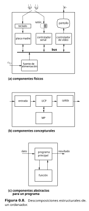

Es interesante observar que "estructura" y "función" suelen aparecer claramente diferenciadas en los sistemas artificiales, pero no en los seres vivos (y lo mismo ocurre entre "función" y "proceso").[^16] Esto es así porque los seres vivos (y los sistemas sociales) cambian estructuralmente con el tiempo, lo que les permite adaptarse y aprender. Pero también las máquinas pueden estar dotadas de esa capacidad. Algunas, por su propia concepción: los autómatas celulares y las redes neuronales. Otras, como el ordenador, por su versatilidad. Volvamos a los modelos estructurales de la figura 0.8. En el primero no tiene sentido pensar en modificaciones estructurales: las "placas" se conectan en una configuración fija y ni ellas ni sus partes cambian. Lo mismo puede decirse, en principio, en el segundo modelo estructural, aunque cabe señalar que se han propuesto algunos modelos adaptables para la unidad central de procesamiento (véase nota a pie de página en el apartado 5.9). Consideremos, sin embargo, el modelo de la figura 0.8(c). Más arriba hemos concretado diciendo que el "programa principal" lee un dato, escribe un resultado y realiza algunas transformaciones, mientras que la "función" calcula el factorial. Pero el mismo modelo es aplicable de manera más general. Supongamos que el "programa principal" recibe como datos una secuencia de letras que forman una frase en español y entrega como resultados una secuencia de sonidos por un altavoz, y que la "función" modifica la estructura del programa dependiendo del parecido que hay entre estos sonidos y la pronunciación correcta de la frase. Si se consigue que a medida que se van sucediendo estímulos y respuestas vaya mejorando ese parecido hasta que, finalmente, el sistema responda bien ante frases que nunca antes había oído ¿no podemos decir que el ordenador "ha aprendido a leer"? (no a comprender). [^17]

### Modelos procesales

Así como un modelo funcional describe la *función dinámica externa* (relaciones entre sistema y entorno) y un modelo estructural describe la *organización estática interna* (partes y relaciones), un modelo procesal describe la *actividad dinámica interna o proceso* de un sistema material. En efecto, si el sistema exhibe un comportamiento dinámico en sus relaciones con el entorno, necesariamente tienen que producirse cambios en su interior. Un modelo procesal describe estos cambios haciendo abstracción de la estructura. Los conceptos básicos para tal abstracción son los de *estado* y *transición* entre estados. El **estado** es una entidad abstracta, conceptual, que podemos definir como *la información mínima necesaria en un instante dado para, conociendo la evolución de los estímulos a partir de ese instante, predecir la evolución de las respuestas*. El estado resume, por tanto, la historia anterior del sistema. Ante un estímulo en un instante, el estado cambia, y a este *cambio* de un estado al siguiente se le llama **transición**.[^18]

Un **proceso** es una sucesión de estados y transiciones (y de respuestas asociadas a los mismos). Su descripción formal se hace mediante dos funciones matemáticas: la de transición y la de salida. La **función de transición** determina el estado siguiente, dependiendo del estado actual y del estímulo que se reciba, y la **función de salida** determina la respuesta para el estado actual y el estímulo recibido (figura 0.9). A partir del estado en un determinado instante y de los estímulos que desde ese instante se vayan recibiendo, el modelo procesal determinará el *proceso* que seguirá el sistema, es decir, la secuencia de estados, de respuestas y de transiciones entre estados.

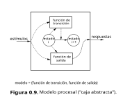

Obsérvese que un modelo procesal es un sistema conceptual, y como tal no tiene sentido decir que esté en un estado u otro.[^19] Un proceso, por el contrario, es un sistema material (las actividades internas son reales, aunque ses abstraigan en el modelo), y como tal en cada momento estará en un estado.

En un sistema que se modele con un número finito de estados, $Q=\{q_0, q_1,...,q_n\}$, un número finito de estímulos diferentes, $E=\{e_0, e_1, ..., e_m\}$ y un número finito de respuesas diferentes, $\{s_0, s_1,...,s_r\}$, las funciones de transición f y de salida, g, son discretas: $q_{t+1} = f(e_t, q_t)$ y $s_{t+1} = g(e_t, q_t)$, donde "t" se refiere al "instante actual" y "t + 1" al "instante siguiente".

Ya habíamos avisado que los conceptos de los modelos procesales son abstractos. Quizás a algún lector se lo parezcan demasiado. Para ayudarle, concretaremos con algunos ejemplos en el siguiente apartado. Terminamos éste con una consideración similar a la que hacíamos más arriba con respecto a los "sistemas abiertos": el concepto de proceso, aquí definido de manera general, se utiliza en el campo de los ordenadores con un significado mucho más concreto, como veremos en el apartado 19.8.

## 0.4 Ejemplos de sistemas y modelos

Los ejemplos que siguen se refieren a sistemas de distinta naturaleza. El lector puede encontrar, dependiendo de sus conocimientos previos, mayor o menor dificultad para la comprensión de los modelos, pero esperamos que, en su conjunto, sirvan estas ilustraciones para que capte las diferencias entre modelos funcionales, estructurales y procesales.

### Ejemplo 1: un sistema mecánico

Consideremos nuevamente la figura 0.5, introducida para ilustrar que un sistema eléctrico (parte inferior) es un modelo analógico de un sistema mecánico (parte superior).[^20] Las ecuaciones matemáticas que aparecen son modelos funcionales de los correspondientes sistemas. En efecto, en el sistema mecánico podemos considerar que la "entrada" o "estímulo" (acción del entorno sobre el sistema) en cada momento es la fuerza aplicada, F(t), y que la "salida" o "respuesta" es el desplazamiento de un punto del sistema, x(t), con relación a la posición de reposo. La ecuación resume todas las relaciones posibles entre la entrada y la salida. Así, si como consecuencia de una fuerza aplicada en el instante $t=0$ el desplazamiento es $x > 0$ y si a partir de ese momento nose aplica ninguna fuerza ($F(t)=0$ para $t>0$), la evolución de la salida, $x(t)$, se puede obtener matemáticamente integrando la ecuación; el resultado, gráficamente, es el que puede verse en la figura 0.10: un movimiento oscilatorio amortiguado.

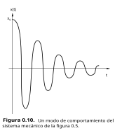

El modelo estructural del sistema mecánico se obtiene teniendo en cuenta que está formado por tres partes que actúan de manera interrelacionada: una masa, un amortiguador, y un resorte. La fuerza total aplicada se distribuye entre las tres:

$$F(t) = F_m(t)+F_a(t)+F_r(t)$$

y el comportamiento (modelo funcional) de cada parte viene dado por leyes de la Física:

$$F_m(t) = M . \frac{d^2x}{dt^2}$$

$$F_a(t) = D . \frac{dx}{dt}$$

$$F_r(t) = K . x $$

Obsérvese que el modelo estructural, al definir por completo la interrelación entre partes y el modelo funcional de cada parte, determina totalmente el modelo funcional del sistema.

Para establecer un modelo procesal hemos de definir las *variables de estado*. De acuerdo con la definición de "estado" dada anteriormente, estas variables deben ser tales que baste con conocer sus valores en un instante $t=t_0$ y los valores de $F(t)$ desde $t = t_0$ hasta $t > t_0$ para poder calcular $x(t)$ en $t > t_0$. Pueden servir como variables de estado $x(t)$ y $v(t)=\frac{dx(t)}{dt}$: desde un punto de vista matemático, para integrar la ecuación que aparece en la figura 0.5 (y poder así calcular x(t)) hacen falta dos condiciones iniciales: $x(t_0)$ y $x'(t_0)$; desde un punto de vista intuitivo, basta conocer la posición y la velocidad con que se mueve el sistema en un momento para saber dónde va a estar después. El modelo procesal viene dado por las *ecuaciones de estado*:

$$\frac{dx(t)}{dt}=v(t)$$

$$\frac{dv(t)}{dt}=-\frac{K}{M}.x(t) - \frac{D}{M}.v(t) + \frac{1}{M}.F(t)$$

que determinan, de forma continua, el cambio de un estado (x(t), v(t)) al siguiente. El **espacio de estados** es el conjunto de valores posibles del par (x(t), v(t)): todo el plano real. A partir de un estado inicial, y para un estímulo F(t), la sución de estados (puntos en el plano) forma una **trayectoria**. En la figura 0.11 puede verse la trayectoria corresponiente al caso de la figura 0.10 ($x(t_0)>0$, $v(t)=0$ y $F(t)=0$ para $t>t_0$).

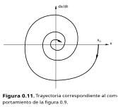

### Ejemplo 2: un sistema ecológico

Consideremos dos especies animales, una de depredadores y otra de presas. Para establecer un modelo, hagamos las siguientes hipótesis:

1. Las variables $P(t)$ y $D(t)$ representarán a los números de presas y de depredadores existentes en el instante $t$. Sus valores son números enteros, pero nuestro modelo las tratará como variables continuas (con valores reales).
2. Las presas se reproducen sin limitación; si no hubiese depredadores su crecimiento sería exponencial.
3. Los depredadores viven y se reproducen si hay suficientes presas; si no hubiese presas, su número tendería asintóticamente a cero.
4. La tasa de crecimiento de la población de presas depende, por una parte, del número de presas (cuanto más hay, más crece), y, por otro, del *número de encuntros*, que es proporcional al producto $P(t) \times D(t)$ (cuanto más hay menos crece la población).
5. La tasa de crecimiento de la población de depredadores depende igualmente del número de depredadores (cuanto más hay, menos crece, porque tienen que repartirse a las presas), y del número de encuentros (cuanto más hay, más crece).
6. Abstraemos cualquier iteración con el entorno.

Esta último hipótesis equivale a decir que el modelo es un *sistema cerrado*. Por tanto, no existe modelo funcional.

Teniendo en cuenta las hipótesis 4 y 5 es fácil expresar gráficamente las relaciones entre tipo de modelo estructural se llama *diagrama causal*.

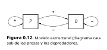

Y combinando todas las hipótesis tampoco es difícil cuantificar las relaciones:

$$\frac{dP}{dt}=K_{11}.P - K_{12}.P.D$$
$$\frac{dD}{dt}= -K_{22} . D + K_{21}.P.D$$

Estas son las conocidas *ecuaciones de Volterra*, que constituyen un modelo procesal de nuestro sistema.

### Ejemplo 3: un sumador binario

Los dos ejemplos anteriores se referían a *sistemas continuos*: las magnitudes de interés toman valores en una escala de números reales. Por ese motivo, los modelos están expresados en el tipo de ecuaciones matemáticas que permiten trabajar con variables de esta naturaleza. Veamos ahora un sistema que es *discreto*, en el sentido de que las magnitudes sólo pueden tomar, en cada momento, uno de entre un conjunto finito de valores, y además los cambios de esos valores no ocurren continuamente a lo largo del tiempo, sino solamente en instantes determinados. Se trata de un sistema electrónico digital sencillo: un sumador binario serial.

En primer lugar, su *descripción funcional*. Un sumador binario es un sistema que suma dos números expresados en el sistema de numeración de base 2 y da el resultado en el mismo sistema.[^21] En los ordenadores es un componente de la unidad aritmética y lógica que funciona en paralelo, es decir, los *bits* (dígitos binarios) que constituyen los sumandos se presentan todos al mismo tiempo (es un circuito combinacional[^22]), pero aquí consideramos el caso del sumador *serial*: los bits de los sumandos se presentan secuencialmente y por parejas: primero se presentan los dos bits de menor peso, el sumador los suma y obtiene el bit de menor peso del resultado (y toma nota del acarreo, si lo hay, pero esto es una actividad interna), luego los siguientes, etc. La figura 0.13 presenta al sistema como una caja negra, y en la figura 0.14 puede verse un ejemplo de comportamiento que corresponde a 011001+011101 = 110110.[^23] En realidad, el comportamiento está definido por los valores de la entrada y la salida, pero la figura incluye más información: la variable *interna z* representa al acarreo; $q$ (también interna) es el "acarreo retardado", o acarreo de la suma binaria en el instante $t-Θ$, que ha de sumarse con $e_1^t$ y $e_2^t$ en el instante $t$. $R$ es la "señal de reloj", que marca el período, $Θ$, de presentación de los estímulos, y éste sí es un parámetro funcional importante. El modelo funcional (que incluye a todos los comportamientos particulares posibles) puede expresarse formalmente de una manera muy sencilla: $S=E_1+E_2$, donde $S$, $E_1$, y $E_2$ representan de manera general números expresados en binario (cadenas de bits).

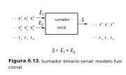

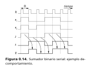

Un *modelo estructural* del sumador consta de dos componentes, una "etapa de sumador" y un "circuito de retardo", conectados según indica la figura 0.15. Para que el modelo estructural esté completo (y pueda determinar al modelo funcional) hay que dar modelos funcionales de ambos componentes. Si $e_1$, $e_2$, $s$, $z$, y $q$ representan dígitos binarios, estos modelos son:

Para la etapa de sumador:

$$s=(e_1 + e_2 + q)(mod 2)$$

$$
z = 
\begin{cases} 
0 & \text{si } e_1+e_2 + q = 0 \text{ o si } e_1 + e_2 + q = 1 \\
1 & \text{si } e_1 + e_2 + q = 10 \text{ o si } e_1 + e_2 + q = 11
\end{cases}
$$

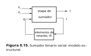

Es decir, $s$ es el bit menos significativo de la suma binaria de los dos bits que se presentan en un momento dado a la entrada, junto con el posible acarreo ($q$) de la suma anterior, y $z$ es el acarreo generado que ha de guardarse para la suma de los siguientes.

Para el circuito de retardo:

$$q(t) = z(t-Θ)$$

donde $Θ$ debe coincidir con el periódo de presentación de los estímulos (bits) a la entrada. Es decir, el acarreo que en cada momento hay que sumar es el que se haya podido generar en la suma de los bits precedentes.

Obsérvese que en la especificación de la etapa de sumador no se ha indicado explícitamnte que las variables son función del tiempo ($s(t)$, $e1(t)$, etc..). Podemos proceder así porque este componente no tiene "memoria": su respuesta en un instante depende solamente de las entradas en ese instante (desde el punto de vista electrónico, es un "circuito combinacional").

Finalmente, veamos el *modelo procesal* del sumador binario serial. Más arriba hemos definido el concepto de "estado" como "información mínima necesaria en un instante dado para, conociendo la evolución de los estímulos a partir de ese instante, predecir la evolución de las respuestas". En este caso, la única información necesaria para poder predecir la salida en si ha habido acarreo anteriormente o no. Es decir, el sistema puede estar en uno de dos estados posibles, que podemos representar con los símbolos $q_0$ (correspondiente a $q=0$, no acarreo previo) y $q_1$ (correspondiente a $q=1$). El *espacio de estados* es finito, y consta sólo de dos "puntos" (dos estados concretos):

$$Q = \{q_0, q_1\}$$

El conjunto de estímulos diferentes también es finito:

$$E=\{00, 01, 10, 11\}$$

así como el de respuestas:

$$S=\{0,1\}$$

Como decíamos antes, dados el estado actual y el estímulo, la función de transición, $f(e,q)$, debe dar el estado siguiente, y la función de salida, $g(e,q)$, la respuesta. Por ejemplo, si hay acarreo ($q=1$) y el estímulo es $e_1=1, e_2=0$, la respuesta debe ser $s=0$ y el acarreo $z=1$, es decir: $g(10,1)=0, f(10,1)=1$. Un análisis exhaustivo de las $4 \times 2 = 8$ combinaciones posibles de entradas y estados nos permite especificar completamente las funciones $f$ y $g$. En la figura 0.16 aparece esta especificación en dos formas equivalentes: como una *tabla de transiciones* y como un *diagrama de transiciones*.

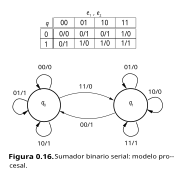

La tabla indica los ocho valores de la función $f$ (los escritos delante de los símbolos "/") y los ocho valores de $g$ (los escritos detrás). En el diagrama, los círculos corresponden a estados, y los arcos a transiciones entre estados; cada arco, etiquetado "$e_1e_2/s$", corresponde a una transición de un estado a otro (que puede ser el mismo) debida a la entrada $(e_1, e_2)$, generándose la salida $s$.

Los tres modelos (funcional, estructural y procesal) son tres formas distintas de *descripbir* al mismo sistema. Dependiendo de lo que se pretenda puede ser más interesante uno u otro. Así, desde un punto de vista de "usuario" (un diseñador de un sistema de nivel superior, en el que se utiliza éste como componente o subsistema), lo que importa es el modelo funcional (incluido el parámetro $Θ$). Pero desde un punto de vista de "diseñador" los modelos más útiles son el estructural y el procesal.

### Ejemplo 4: un programa de ordenador

Volvamos al ejemplo del apartado anterior sobre el modelo estructural de un programa de ordenador (figura 0.8(c)) cuyo modelo funcional es "resultado=factorial(dato)". El modelo procesal puede verse en la figura 0.17, a la que añadiremos estos comentarios:

1. Inicialmente, mientras el ordenador no empiece a ejecutar el programa, el proceso no existe. El modelo procesal incluye un estado inicial para esta situación al que llamamos *nonato*.

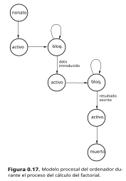

2. En cuanto el programa empieza a ejecutarse, el proceso pasa al estado *activo*, pero durante un tiempo muy pequeño, porque lo primero que hace es "pedir" un dato.

3. La unidad ("periférico") por la que se introduce el dato (el teclado, por ejemplo), es mucho más lenta que la unidad de procesamiento. Mientras no se haya terminado de leer el dato, el proceso no puede continuar: está *bloqueado*.

4. Una vez obtenido el dato, el proceso vuelve a estar *activo*. Durante este segundo estado activo el programa hace la transformación a la representación interna, llama a la función, ésta calcula el factorial y el programa traduce el resultado a la representación a escribir por la pantalla.

5. De nuevo el proceso pasa a *bloqueado*, ahora esperando que el resultado quede escrito.

6. Terminada la salida del resultado, el proceso vuelve a estar activo (seghuramente, y como al principio, por muy poco tiempo).

7. Como el proceso ha terminado, pasa al estado *muerto*.

Este es un modelo procesal para un programa concreto. En el apartado 19.8 estudiaremos un modelo genérico, de gran importancia para el estudio del funcionamiento del ordenador durante la ejecución de programas.

### Ejemplo 5: una casa encantada

"Querido amigo:

Al poco de comprar esta vieja mansión me sorprendió desagradablemente el comprobar que está hechizada con dos sonidos que la hacen prácticamente inhabitable: un canto picaresco y una risa sardónica.

Aún conservo, sin embargo, alguna esperanza, pues la experiencia me ha demostrado que su comportamiento obedece a ciertas leyes, oscuras pero infalibles, que permiten modificarlo tocando el órgano y quemando incienso.

En cada minuto, cada sonido está presente o ausente. La situación en el minuto siguiente es así:

El canto conserva el mismo estado (presente o ausente) salvo si en el minuto actual no se oye la risa y toco el órgano, en cuyo caso el canto pasa al estado opuesto. 

En cuanto a la risa, si no quemo incienso, aparece o no según que el canto estuviese presente o ausente (de modo que la risa imita al canto con un minuto de retardo). Ahora bien, si quemo incienso la risa hace justamente lo contrario de lo que hace el canto. En el momento en el que le escribo estoy oyendo a la vez la risa y el canto. Le quedaré sumamente agradecido si me aconseja sobre las manipulaciones de órgano e inclienso que debo seguir para restablecer definitivamente la calma."

El comportamiento que describe esta carta (tomada de un inolvidable libro de Ross Ashby[^24]) caracteriza a un sistema cuyas entradas y salidas se pueden formalizar con variables binarias: I, O (entradas), R y C (salidas) (I=0 si no se quema incienso, I=1 si se quema, etc.). El mismo texto de la carta es ya un *modelo funcional*, que como se puede formalizar con el lenguaje de la lógica:

párrafo 4: $C_{t+1} = C_t \oplus (\bar{R_t} . O_t)$  
párrafo 5: $R_{t+1} = I_t \oplus C_t $  

También podemos establecer un *modelo estructural*, considerando dos componentes, los agentes que generan la risa y el canto y las influencias mutuas entre ellos y con las entradas (figura 0.18). Pero el más interesante para este ejemplo es un *modelo procesal* que, como veremos, conduce inmediatmanete a una solución del problema.

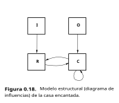

$R$ y $C$ son las variables de estado (además de ser las de salida). En efecto, según explican los párrafos 4 y 5 de la carta, basta con saber qué valor tienen esas variables en un minuto determinado y qué estímulos (valores de $I$ y $O$ ) se dan en ese minuto para conocer los valores que tomarán $R$ y $C$ en el minuto siguiente.

El espacio de estados consta así de cuatro estados:

* $q_0$, correspondiente a $R=0$, $C=0$ (no se oye la risa ni el canto)
* $q_1$, correspondiente a $R=0$, $C=1$ (no se oye la risa, sí el canto)
* $q_2$, correspondiente a $R=1$, $C=0$ (se oye la risa, no el canto)
* $q_3$, correspondiente a $R=1$, $C=1$ (se oye la risa y el canto)

En  cada uno de estos cuatro estados pueden aplicarse cuatro estímulos diferentes:

* $e_0$: $O=0, I=0$ (no tocar el órgano ni quemar incienso)
* $e_1$: $O=0, I=1$ (no tocal el órgano pero quemar incienso)
* $e_2$: $O=1, I=0$ (tocar el órgano pero no quemar incienso)
* $e_3$: $O=1, I=1$ (tocar el órgano y quemar incienso al mismo tiempo)

Pues bien, basta con considerar detenidamente los párrafos 4 y 5 de la carta para especificar por completo la función de transición, es decir, para determinar las 4 x 4 = 16 transiciones entre estados. El resultado, en forma de diagrama de transiciones, puede verse en la figura 0.19.

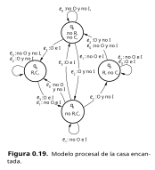

A la vista de este diagrama, la solución al problema que plantea la carta aparece fácilmente: el estado inicial es $q_3$; de él se puede pasar a $q_1$ mediante $e_1$ o $e_3$, y de éste a $q_0$ mediante $e_3$. Expresándolo en los mismos términos epistolares: "Durante un minuto, queme usted incienso, y, si le apetece, toque también el órgano; desaparecerá la risa. Durante el minuto siguiente queme incienso y toque el órgano a la vez, y al finalizar ese minuto cese toda actividad. Si no vuelve a manipular ni el órgano ni el incienso, se habrá lirado para siempre del encantamiento".

Hemos considerado como salidas $R$ y $C$, que son también las variables de estado (por este motivo, en este caso las ecuaciones de estado son las mismas ecuaciones del modelo funcional escritas más arriba). También podemos definir una salida binaria, $s$, que represente la presencia o ausencia de algún sonido:[^25]

* $s=0$ si no hay ningún sonido ($R=0$, $C=0$)
* $s=1$ si hay algún sonido

El lector puede observar en el diagrama otras soluciones (con secuencias de estímulos más largas que la propuesta). Observe también que, afortunadamente para el propietario de la casa, el estado $q_0$ (el único con $s=0$) es estable para la entrada $e_0$

## 0.5 Artefactos y herramientas, diseñadores y usuarios

Analicemos ahora la vertiente pragmática de los modelos. Un modelo de un sistema puede servir a la persona que hace uso de él para varios fines:

* Utilizar el sistema: saber qué estímulos tiene que darle para obtener un comportamiento deseado. En este caso normalmente interesa disponer de un modelo funcional, pero (como pone de manifiesto el último ejemplo) a veces resulta más útil un modelo procesal.

* Diseñar, rediseñar, implementar, reparar o mantener el sistema. En estas actividades suele dominar el uso del modelos estructurales y procesales.

* Simplemente, comprender el sistema. La motivación puede ser un puro interés científico, o un paso previo para alguna de las actividades anteriormente enunciadas. Por ejemplo, en este libro presentamos modelos pensados para que el lector comprenda los ordenadores. El objetivo final es que el lector se convierta en (o perfeccciones sus habilidades como ) usuario y/o diseñador de ordenadores o de sistemas construidos con él (así lo esperamos). Para una compresión cabal del sistema hay que estudiar modelos funcionales, estructurales y procesales.

### Artefactos y herramientas

Un ordenador es un *artefacto*: algo *hecho con arte*. El diseño de ordenadores tiene, en efecto, mucho de "artístico". Al mismo tiempo un ordenador es una *herramienta*: un objeto que ayuda en la resolución de problemas (entre los cuales se encuentra el diseño de artefactos, ordenadores incluidos).

En general, un **artefacto** es un sistema material o conceptural concebido y construido por el hombre, y una **herramienta** es un artefacto que tiene un fin específico: el de usarlo como ayuda para la resolución de ciertos problemas. Un automóvil y un edificio son (como el ordenador) artefactos y herramientas, y también lo son, aunque se trate de sistemas conceptuales, la lógica y las teorías matemáticas. Las obras de arte son artefactos, pero normalmente, no son herramientas. Todas las herramientas son artefactos (excluimos las "herramientas primitivas" que se encuentran en la naturaleza). Los sistemas naturales no son artefactos, y, por tanto, tampoco herramientas (aunque a veces se usen como si lo fueran).

Las intenciones y las motivaciones de las personas que tratan con un mismo artefacto (y, en general, con un mismo sistema) pueden ser muy variadas. De ahí que el mismo sistema pueda verse de muchas maneras diferentes, o, lo que es lo mismo, que puedan formularse diferentes tipos de modelos en diferentes niveles de abstracción.

### Adecuación de las descripciones

Ya sabemos que toda descripción de un sistema es un modelo del mismo. Diferentes observadores, contemplando la misma realidad, pueden elaborar o encontrar útiles descripciones muy diferentes para esa realidad. Ello no implica necesariamente que unas descripciones se ajusten más o menos que otras a la realidad. La mejor descripción para una determinada persona no es la más detallada, sino la que mejor le permite resolver los problemas que se plantea.

Consideremos un sistema natural particularmente complejo: el hombre. Si se nos pide una descripción de una persona determinada seguramente daremos una relación de sus rasgos fisionómicos más destacados, es decir, un modelo estático y de "caja negra" (funcional). Para más detalles, trataríamos de describir su "personalidad", que incluye rasgos de comportamiento dinámico, y al hacerlo formularíamos de manera informal e incompleta algún modelo procesal ("le gusta tal cosa, le enfada tal otra..."). Pero el hombre, como sistema, es objeto de estudio de diferentes ciencias, y en cada una de ellas se han elaborado distintos modelos. La psicología conductista, por ejemplo, utiliza sobre todo modelos funcionales con los que estudia las respuestas humanas ante los estímulos, mientras que la psicología cognoscitiva trata con modelos de representación del conociemiento en la mente humana (modelos estructurales) y de procesamiento de la información (modelos procesales). En medicina se utilizan modelos estructurales estáticos (anatomía) y funcionales y procesales dinámicos (fisiología). Para un sociólogo, el hombre es un componente de los sistemas sociales, caracterizado por ciertos rasgos de comportamiento (por tanto, por algún modelo funcional), y para un ingeniero puede ser el objeto último de su profesión (considerando que el objetivo de la ingeniería es la producción de artefactos que redunden en la mejora de la calidad de vida), un objeto inmediato (diseño ergonómico de interfaces hombre-máquina), o, incluso, una fuente inspiradora de modelos (en la línea de lo que algunos llaman "biónica"). En cada caso, el criterio para elegir una descripción (un modelo) y descartar otras depende, sobre todo, de la adecuación de esa descripción al tipo de problemas que se pretende abordar con ella.

Como ejemplo de artefacto (y herramienta) tomemos el automóvil. Para el usuario normal el automóvil es una herramienta, y su mejor descripción es un modelo funcional: le basta con saber cómo responde el vehículo ante los "estímulos" de girar el volante, pisar el freno, etc. Algunos usuarios especiales, como los pilotos de pruebas, pueden requerir modelos funcionales más detallados. [^26] Pero para los profesionales de la industria del automóvil éste no es ya una herramienta, sino el objeto central de su trabajo; en general, no les bastan los modelos funcionales, y tienen que disponer de modelos estructurales y procesales, diferentes para cada especialidad.

Los modelos para la comprensión son generalmente conceptuales, más o menos formalizados, aunque en ocasiones la comprensión se facilita mediante un modelo analógico (por ejemplo, cuando se explican los rudimentos de la electricidad mediante un "símil hidrodinámico"). Los típicos modelos para uso son los "manuales de usuario"; generalmente se trata de descripciones informales, pero como veremos enseguida el usuario del sistema puede ser un diseñador de otro sistema (de "nivel superior"), y en tal caso se hacen necesarios modelos formalizados.

### La actividad de diseño

El término "diseño" se aplica tanto en la ingeniería como en actividades muy distantes de ella en el plano axiológico (los valores esenciales en esas actividades son de naturaleza estética) y en otras de naturaleza "mixta" (arquitectura, urbanismo...). Todas estas actividades comparten una orientación creativa, la idea de ensamblar partes para construir un sistema con ciertos fines.

El objeto de la actividad de diseño es siempre un *artefacto*. Son artegfactos un automóvil, un ordenador, un edificio..., pero también un sistema axiomático, un sistema de transporte, un sistema social...Puede discutirse si el diseño del segundo tipo de sistemas es "ingeniería", pero hay princpios y herramientas que son de utilidad en el diseño de ciertos tipos de sistemas y que pueden extenderse a otros.

En el proceso de diseño se pueden utilizar como herramientas sistemas materiales o concepturales. La herramienta material más general y flexible es el ordenador, que, con técnicas de simulación y visualización, permite prever el funcionamiento del sistema que se está diseñando; esto es lo que se llama CAD ("Computer-Aided Design": diseño asistido por ordenador). Las herramientas concepturales son las teorías, metodologías y modelos disponibles para el tipo de artefacto a diseñar.

El diseño de un artefacto suele incluir muchas facetas, y con frecuencia sólo se dispone de modelos formalizados y sustentados por una teoría para algunas de ellas. Esta carencia se suple con *heurísticos*: "trucos" o reglas empíricas cuya utilidad está avalada por la experiencia.

### Usuario y diseñadores

El ordenador se puede considerar como una herramienta (punto de vista del usuario) o como un artefacto a construir (punto de vista del diseñador). Pero esta diferenciación no es tan neta como a primera vista pudiera parecer: el diseñador de programas de aplicación es usuario de un sistema operativo; el diseñador de éste es usuario de una máquina hardware, diseñada haciendo uso de placas, que están construidas con circuitos integrados...Cada una de estas personas necesita modelos diferentes para ejercer su actividad: en general, el usuario de un sistema necesita un modelo funcional del mismo, y utiliza modelos estructurales y procesales de los sistemas que diseña con él.

### Diseño, implementación y especificaciones

En las actividades ligadas a la concepción y construcción de un artefacto es útil distinguir entre **diseño** e **implementación**. El diseño comienza con una descripción de las funciones pretendidas (un *modelo funcional) del sistema, y termina con una descripción de los componentes abstractos y sus interrelaciones y procesos (modelos estructural abstracto y procesal). En la implementación se materializa el modelo estructural en otro cuyos componentes son concretos. La figura 0.20 (que el lector debe situar en el contexto de la figura 0.3) muestra los tipos de modelos más ligados a cada actividad.

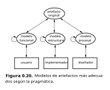

Además de su utilidad dentro de cada actividad, los modelos también son vehículos de comunicación entre unas actividades y otras. Cuando sirven a esta función, los modelos suelen llamarse **especificaciones**. Y, para reducir al mínimo posible los errores de comunicación, conviene que estos modelos estén expresados en un *lenguaje formal*. Se habla entonces de *especificaciones formales*.

Para ilustarar lo anterior, volvamos al ejemplo del sumador binario. Partiendo de su especificación funcional, el resultado del diseño es el modelo procesal de la figura 0.16 y el estructural de la figura 0.15. La implementación en este caso consistiría en buscar los componentes físicos (sistemas electrónicos digitales) que tengan las funciones requeridas por el modelo estructural. 

Un hecho interesante aparece aquí: al bajar el nivel de abstracción, en la implementación pueden ponerse de manifiesto restricciones físicas que obligan a volver sobre las especificaciones del diseño. Así, en la especificación funcional podría haberse decidido un determinado valor, muy pequeño, del parámetro $θ$ (intervalo entre presentación de los bits). En el modelo estructural procedente del diseño, este valor es el que debe tener el "elemento de retardo". Pero supongamos, ya en la implementación, que al buscar un componente electrónico que materialice a este elemento,[^27] no encontramos ninguno con ese valor tan pequeño.[^28] En este caso sencillo no hay más solución que relajar las especificaciones (conformándose con un sistema más lento); en otros, en los que existen modelos alternativos, es posible rehacer el diseño de modo tal que la implementación sea factible.

La implementación no siempre consiste en construir un modelo estructural con componentes físicos. El caso más notorio es el que se da en programación. Para el diseño de un programa se parte de unas especificaciones funcionales y se llega a un modelo estructural de componentes abstractos, definido cada uno por su función. Así, en el ejemplo del programa para el cálculo del factorial se podría llegar a la descomposición en componentes o *módulos* que resumía la figura 0.18(c). Para programas complejos esta descomposición modular es recursiva: para cada módulo se establecen un modelo estructural y un modelo procesal, cada componente del mismo vuelve a descomponerse, y así sucesivamente hasta llegar a funciones simples. En cualquier caso, el modelo estructural resultante incluye módulos definidos funcionalmente. La implementación consiste en este caso en plasmar esas funciones abstractas en construcciones concretas con un lenguaje de programación.

### Productos y ciclo de vida

Más arriba hemos visto, en un ejemplo sencillo (el del sumador binario), que como resultado de la implementación puede ser necesario rehacer las especificaciones para el diseño.

Entendemos por "*producto*" un artefacto que se obtiene como resultado de un proceso de fabricación. Es decir, no sólo es un sistema diseñado e implementado por el hombre; este diseño y esta implementación están condicionados por la existencia de un mercado y, frecuentemente, de una normativa. Cuando el artefacto es un producto, el resultado de la implementación es un **prototipo**, que debe someterse a pruebas antes de su producción o fabricación. Como resultado de estas pruebas, y también a lo largo de la vida del producto es posible que aparezca de nuevo la necesidad de un rediseño.

La figura 0.21 ilustra esta naturaleza recurrente de las actividades ligadas a concepción, construcción y uso de un producto. El *modelo conceptual* es una descripción de la funcionalidad del sistema, y el diseño consiste en transformar esas especificaciones funcionales en modelos estructurales y procesales.

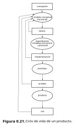

La sucesión de fases por las que pasa un producto desde su concepción hasta su abandono por obsolescencia o envejecimiento se llama **ciclo de vida**. La figura 0.21 representa un modelo muy general de ciclo de vida. En áreas particulares de la ingeniería se han propuesto ciclos de vida especializados para sus productos. Así, en la *ingeniería del software* un ciclo de vida "clásico" es el formado por las fases sucesivas de *planificación, análisis de requisitos* (correspondientes, aproximadamente, a la "concepción" de la figura 0.21), *diseño, codificación* (que corresponde a "implementación"), *pruebas y evaluación y mantenimiento*.

## 0.6 Jerarquías de abstracciones

Un ordenador es un *sistema complejo* que puede describirse mediante diferentes *modelos, en distintos *niveles* de una *jerarquía de abstracciones*. Esta era nuestra declaración inicial, y el objetivo de esta lección es profundizar en su significado y en sus consecuencias. Ya hemos hablado de "sistemas", "complejidad" y "modelos", hemos visto tres tipos básicos de modelos conceptuales para sistemas dinámicos (funcionales, estructurales y procesales), hemos explicado que las descripciones son modelos y que a un mismo sistema pueden aplicársele descripciones diferentes por consideraciones pragmáticas. Aclaremos ahora lo que pretendemos significar con "niveles" y "jerarquía de abstracciones". En general en este apartado, y particularizando para los ordenadores en el siguiente.

### Modelos y abstracciones

La modelación y la abstracción son actividades intelectuales indisolublemente unidas. En efecto, el modelo sólo representa los rasgos de interés del original, es decir, *hace abstracción* de los que no son de interés para el propósito del modelo.

En el ejemplo del sumador binario serial abstraíamos detalles como los valores de voltajes que puedan corresponder a "0" y a "1", o como el hecho de que los cambios (de "0" a "1" y de "1" a "0") no son instantáneo, sino que "en realidad" son graduales, con un tiempo de transición. (Las comillas son debidas a que los cambios se describen como graduales, o como funciones continuas del tiempo, en un nivel de abstracción inferior, pero si aún descendemos más en el nivel de abstracción y aplicamos modelos de la física cuántica nos encontramos "en realidad" con cambios nuevamente discretos).

### Jerarquías de niveles de abstracción

Acabamos de sugerir que un mismo sistema (el sumador binario serial) puede describirse no sólo con distintos modelos, sino también en distintos niveles de abstracción.

Pensar en distintos niveles de abstracción es algo habitual en las ciencias que tratan con sistemas complejos. Por ejemplo, en las ciencias biológicas se estudian los niveles bioquímico (biología molecular), de célula (citología), de tejido (histología), de órgano (anatomía) y de organismo. En cada nivel se utilizan los tres tipos de modelos que hemos explicado (aunque no con esos nombres). Así, en el nivel de célula la morfología celular utiliza modelos estructurales (describe a las células como ensamblajes de subsistemas), la fisiología celular utiliza modelos procesales (describe los procesos internos que explican el metabolismo, el crecimiento, la división, etc.) y desarrolla modelos funcionales que son de utilidad para los niveles superiores.

De una manera general, un nivel de abstracción para la descripción de un sistema se caracteriza por:

* La *naturaleza de las variables* que representan a las magnitudes (estímulos, respuestas y estados) de interés: pueden ser continuas o discretas, numéricas o simbólicas.
* El *espacio de estados* en el que se formulan modelos procesales.
* Los *componentes* que permiten establecer modelos estructurales. Estos componentes estarán descritos como modelos funcionales de sistemas del nivel inferior.
* Las *leyes de composición* que rigen la manera de interconectar componentes.
* Las *leyes de comportamiento* que determinan el comportamiento (modelo funcional) de un sistema a partir del modelo estructural del mismo y de los modelos funcionales de los componentes, o bien a partir del modelo procesal.
* El *lenguaje* (o lenguajes) con el que expresamos las leyes y formulamos modelos.

Entre estos niveles existe una relación de orden: los componentes de los modelos estructurales del nivel *i* son sistemas del nivel *i-1*. El distema "final" (aquél para el que se construye la jerarquía) biene descrito por los modelos del más alto nivel. "Descender" (pasar del nivel *i* al *i-1*) en la jerarquía es *concretar* detalles, y "ascender" es *abstraer*. Cuando la jerarquía corresponde a un artefacto, y se utiliza para su construcción, la implementación del sistema del nivel *i* implica un "descenso" al nivel *i-1*.

## 0.7 Jerarquía de niveles para los ordenadores

🚧 TODO 🚧

-----------

[^1]: Obsérvese que este enunciado no es una definición de ordenador, sino la declaración de unas propiedades del mismo. Dicho de otro modo, en él se utiliza el verbo "ser" en el sentido de la *predicación*, no en el de la *identidad*. (J. Ferrater h H. Leblanc: *Lógica matemática*. Fondo de Cultura Económica, México, 1962).

[^2]: Diccionario de la Real Academia Española, vigesimoprimera edición (1992), que citaremos con frecuencia

[^3]: O sea, pudiendo denotar tanto objetos físicos de nuestro entorno material como objetos conceptuales elaborados por la mente. Como dice Javier Aracil: "Se aplica ["cosa"] a todo aquello que nos rodea ante lo que se puede preguntar significativamente: *¿qué es eso?* Se excluye únicamente aquello ante lo que, siguiendo la sugerencia de los orteguianos, cabe cuestionar: *¿quién es ese?* (J. Aracil: *Máquinas, sistemas y modelos. Un ensayo sobre sistémica*. Tecnos, Madrid, 1986).

[^4]: Según el criterio de Aracil citado en la nota anterior, un hombre no es una "cosa", pero sí podría ser un sistema compuesto por cosas. Por otra parte, cuando se estudian sistemas de los que el hombre forma parte (sistemas sociales, sistemas hombre-máquina, etc.) es ogligado tomar el punto de vista del hombre como "cosa".

[^5]: Tabmién intercambia energía, pero los modelos que aquí nos interesan hacen abstracción de este hecho. Obsérvese que el mismo concepto de "información" implica una abstracción: la información ha de tener un soporte para ser almacenada y comunicada, y este soporte implica algún tipo de energía.

[^6]: "La complejidad de un objeto está en los ojos del observador". G.J. Klir: "Complexity: some general observations". *System Research*, 2, 2 (1985), pp. 131-140.

[^7]: H.A. Simon: *The sciences of the Artificial.* M.I.T. Press, 1973. Traducción de F. Gironella: *Las ciencias de lo artificial.* A.T.E., Barcelona, 1978.

[^8]: "No es que tu teoría sea tan amplia como la realidad; es que tu percepción de la realidad es tan estrecha como tu teoría". K. Craik: *The Nature of Explanation*. Cambridge University Press, Cambridge, 1943.

[^9]: M. Bunge: *Epistemología*. Ariel, Barcelona, 1980.

[^10]: "5. Esquema teórico, generalmente en forma matemática, de un sistema o de una realidad compleja (por ejemplo, la evolución económica de un país), que se elabora para facilitar su comprensión y el estudio de su comportamiento". (D.R.A.E.)

[^11]: "Función: Capacidad de acción o acción propia de los seres vivos y de sus órganos y de las máquinas o instrumentos" (D.R.A.E.)

[^12]: Esta es una denominación establecida, pero "caja opaca" se ajustaría más a la idea.

[^13]: No se olvide que "funcional" se refiere a "función", no a "funcionamiento". El funcionamiento (actividad interna) de una sistema se describe mediante un modelo procesal.

[^14]: W.R. Ashby: *An Introduction to Cybernetics*. Chapman and Hall, Londres, 1956. Traducción de J. Santos: *Introducción a la cibernética*. Nueva Visión, Buenos Aires, 1960.

[^15]: "Todo programa real contiene errores mientras no se demuestra lo contrario, lo cual es imposible" (T. Gilb: "Laws of unreliability". *Datamation*, 21,3 (Mar. 1975)). Sólo recientemente se han empezado a desarrollar modelos que permiten, en ciertos casos, garantizar que un programa construido con esos modelos es correcto (véase el apartado 24.2).

[^16]: "La antítesis entre *estructura y función, morfología y fisiología* está basada en una concepción estática del organismo. En una máquina hay una disposición fija que puede ponerse en movimiento, pero también puede permanecer en reposo [...] Realmente, esta separación entre una estructura preestablecida y los procesos que ocurren en la estructura no se aplica al organismo vivo [...] Lo que se llaman estructuras son procesos lentos de larga duración, y las funciones son procesos rápidos de corta duración. (L. von Bertalanffy: *Problems of life: An evaluation of Modern Biological and Scientific Thought.* Watts, Londres, 1952).

[^17]: Un sistema que exhibe este modo de comportamiento (para la lengua inglesa) es "NetTalk". Se basa en la programación de una red neuronal (T.J. Sejnowski y C.R. Rosemberg: *NetTalk: a paralell network that learns to read alout*. Technical Report TR-86-01, Dep. Electrical Eng., Jhon Hopkins Univ., 1986)

[^18]: Al aplicar estos conceptos a los ordenadores (en la Segunda Parte del curso) veremos que los estados se suceden en la mayoría de las ocasiones sin que aparentemente haya ningún estímulo. Esto es así cuando el sistema está "sincronizado", de modo que cada cierto período de tiempo cambia de un estado al siguiente. Pero, en realidad, siempre hay un estímulo: el paso inexorable del tiempo. En los ordenadores y en otros sistemas digitales este estímulo tiene, además, una materialización bien clara: la señal periódica del reloj.

[^19]: "Los objetos concretos o materiales *son* y *están*: existen físicamente y están en algún estado. Los objetos concepturales, en cambio, *son*: existen (conceptualmente), tienen propiedades conceptuales que no posee objeto concreto alguno, tales como la propiedad de ser un conjunto, o una relación, o un espacio. Los conjuntos no se mueven, las funciones no metabolizan, los espacios no procrean, las estructuras algebraicas no pasan hambre, las derivadas no explotan." M. Bunge: *Epistemología.* Ariel, Barcelona, 1980.

[^20]: Evidentemente, la inversa también es cierta: el sistema mecánico puede utilizarse como modelo analógico del eléctrico.

[^21]: En el apéndice A se resume la aritmética con base 2, o *binaria*, en la que sólo hay dos dígitos, 0 y 1.

[^22]: En el apéndice B se resumen los principios de los circuitos lógicos combinacionales y secuenciales.

[^23]: Para interpretar bien la figura 0.14, obsérvese que los dígitos binarios están representados en ella en sentido inverso a como los escribimos sobre el papel.

[^24]: W.R. Ashby, *op.cit.*

[^25]: Obsérvese que aquí, a diferencia del caso del sumador, podemos asociar la salida a los estados, no a las transiciones: $s=0$ está asociada a $q_0$, y $s=1$ a los otros tres; la función de salida es $g(q)$, no $g(e,q)$.

[^26]: Es bien sabido que todos los usuarios pueden, en ocasiones, beneficiarse del conocimiento de modelos estructurales y procesales. Pero cuando un usuario recurre a uno de estos modelos es por una de dos razones: o bien porque su modelo funcional no es  suficiente para resolver todos sus problemas, o bien porque deja de ser estrictamente un usuario (como ocurre cuando el conductor abre el capó).

[^27]: Un biestable, como se explica en el apéndice B.

[^28]: O bien lo encontramos pero a un coste prohibitivo. El criterio de coste, aquí omitido, forma parte importante de las especificaciones iniciales del diseño.